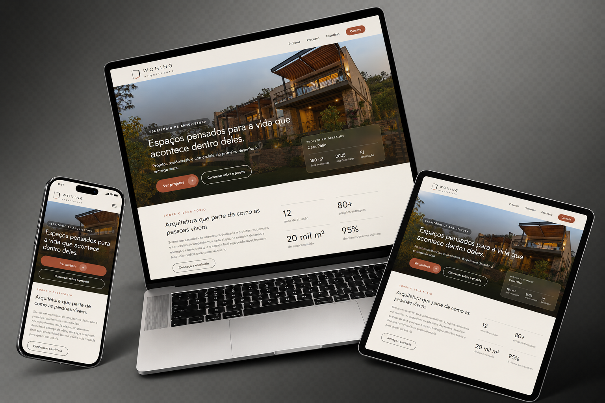

# Woning Arquitetura

Site institucional de um escritório de arquitetura..

**[Ver o site publicado](https://woning-arquitetura.vercel.app/)**



> Projeto conceito: nomes, endereço, contatos, depoimentos e projetos são fictícios.

## Páginas

- **Home**: apresentação, números do escritório, projetos em destaque, processo, depoimentos e chamada para contato
- **Projetos**: galeria com filtro por tipo (residencial e comercial)
- **Detalhe do projeto**: ficha técnica, descrição e galeria de imagens
- **Processo**: etapas do trabalho e perguntas frequentes
- **Escritório**: história, valores e equipe
- **Contato**: formulário e localização
- **404**: página para endereços que não existem

## Tecnologias

- React com TypeScript
- Vite
- Tailwind CSS
- React Router
- Fontes Jost e DM Sans (Google Fonts)
- Publicado na Vercel

## Decisões de design

- Paleta inspirada em materiais de obra: concreto, areia, grafite, oliva e terracota
- Seções que alternam os fundos claros, sem misturar os dois tons
- Interface estática e sem animações automáticas, para deixar as fotos dos projetos em destaque
- Dados dos projetos em um único arquivo (`src/data/projetos.ts`), que alimenta a Home, a galeria e as páginas de detalhe
- Imagens com substituto (o símbolo do escritório) quando a foto não existe
- Rótulos nos campos do formulário, textos alternativos nas imagens e menu acessível pelo teclado

## Como rodar

```bash
npm install
npm run dev
```

Para gerar a versão de produção:

```bash
npm run build
```

## Autora

Projeto criado por Érika Laiane. [GitHub](https://github.com/seu-usuario) · [LinkedIn](https://linkedin.com/in/seu-perfil)